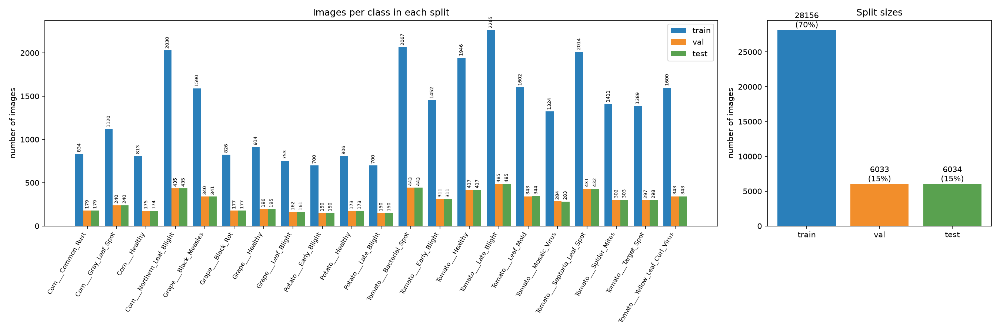
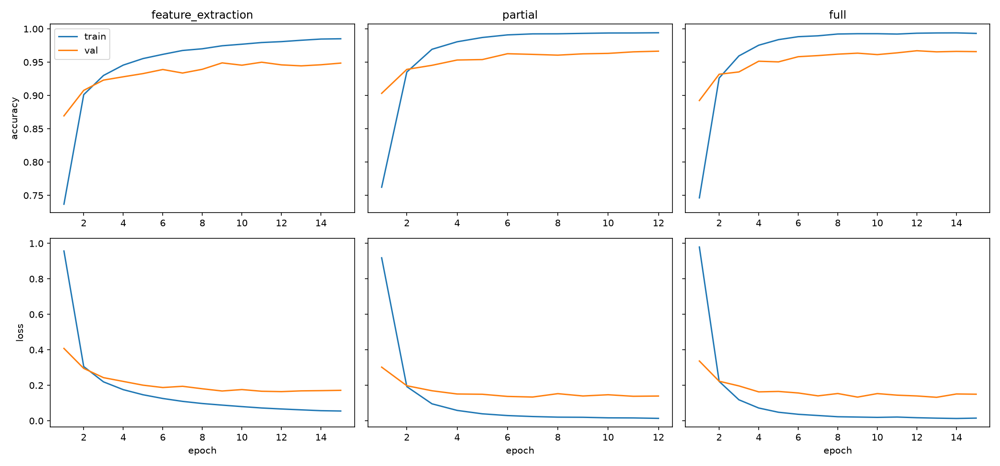
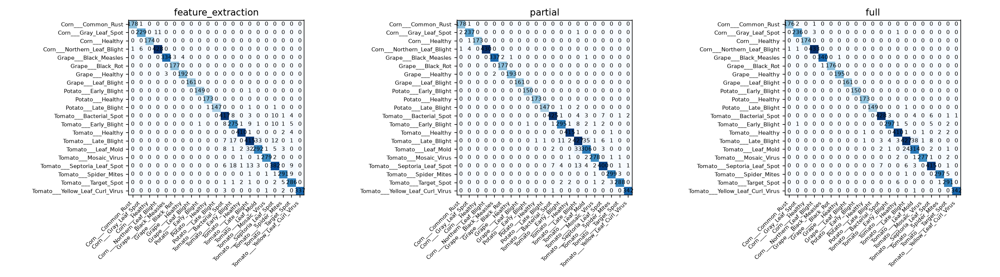
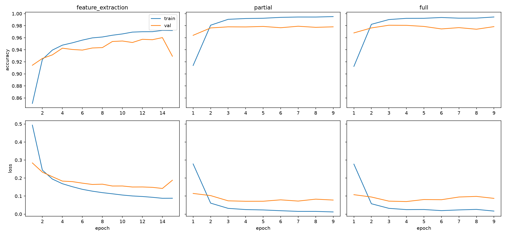
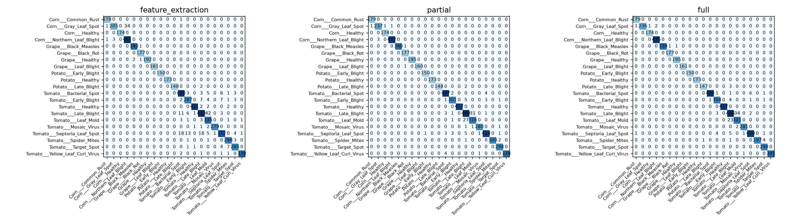
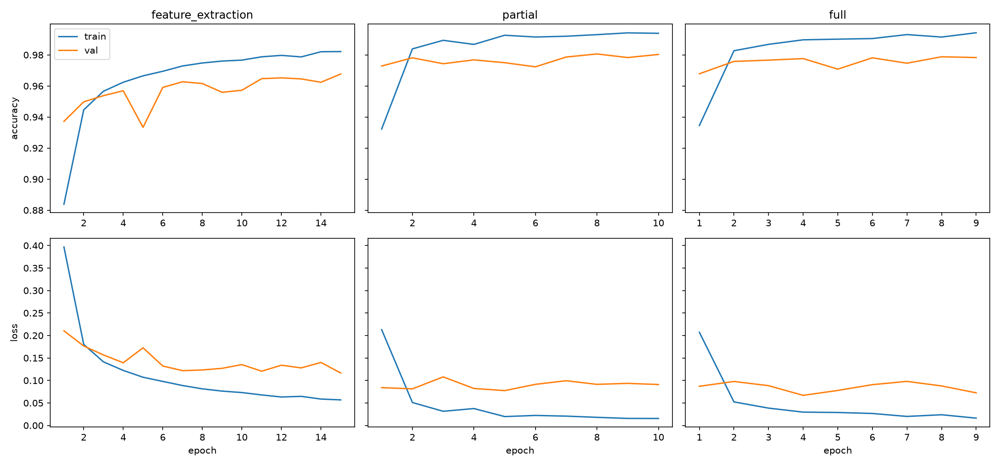
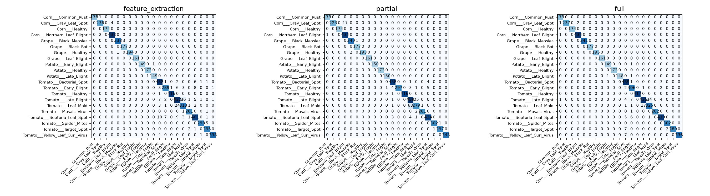

<div align="center">

# Transfer Learning for Plant Disease Detection

**A Comparative Study of EfficientNetV2, MobileNetV4, ConvNeXtV2, and ViT-Base**

**Under Three Adaptation Regimes: Feature Extraction · Partial Fine-Tuning · Full Fine-Tuning**


Département d'Informatique · Faculté des Sciences Semlalia, Université Cadi Ayyad, Marrakech

Supervised by **Pr. Mustapha AATILA**

</div>

---

## Overview

Plant diseases cause significant agricultural losses, and manual diagnosis is slow, subjective and hard to scale. This project asks:

> **To what extent can Transfer Learning enhance plant disease classification, and which combination of architecture and adaptation strategy yields the optimal balance of accuracy, computational efficiency, and robustness?**

Pre-trained ImageNet backbones are adapted to a 21-class leaf-disease dataset with three strategies of increasing depth. Every model is trained under the same hyperparameters, data splits and training loop, so differences come from the architecture and the strategy alone.

### Progress

| Item | Status |
|---|---|
| Dataset download, validation, stratified split | ✅ Done — [`01_data_and_preprocessing.ipynb`](notebooks/01_data_and_preprocessing.ipynb) |
| EfficientNetV2-S × 3 strategies | ✅ Done — [`02_efficientnetv2_strategies_classification.ipynb`](notebooks/02_efficientnetv2_strategies_classification.ipynb) |
| ConvNeXtV2-Tiny × 3 strategies | ✅ Done — [`03_convnextv2_strategies_classification.ipynb`](notebooks/03_convnextv2_strategies_classification.ipynb) |
| ViT-Base/16 × 3 strategies | ✅ Done — [`04_vit_base_strategies_classification.ipynb`](notebooks/04_vit_base_strategies_classification.ipynb) |
| MobileNetV4 × 3 strategies | ⏳ Pending |
| Baseline CNN trained from scratch | ⏳ Pending |
| Grad-CAM interpretability | ⏳ Pending (`grad-cam` is already in `requirements.txt`) |
| Efficiency benchmarks, robustness tests, multi-seed runs | ⏳ Pending |
| Paper | 🚧 Draft in [`paper/`](paper/) |

## Dataset

[Plant Leaf Diseases](https://www.kaggle.com/datasets/moazawadali/plant-leaf-diseases) (Kaggle, `moazawadali/plant-leaf-diseases`, version 3), downloaded with `kagglehub`.

- **40,223 images, 21 classes, 4 crops:** Corn (4 classes), Grape (4), Potato (3), Tomato (10).
- **Imbalance:** from 1,000 images (Potato Early Blight, Potato Late Blight) to 3,235 (Tomato Late Blight), a 3.2 : 1 ratio.
- **Split:** stratified 70 / 15 / 15 with seed 42, after removing unreadable files. The split is saved once in [`data/splits/`](data/splits/) and reused by every model.

| Split | Images |
|---|---|
| Train | 28,156 |
| Validation | 6,033 |
| Test | 6,034 |

Per-class counts are in [`results/split_counts.csv`](results/split_counts.csv).



## Method

### Models

All backbones come from [timm](https://github.com/huggingface/pytorch-image-models) with ImageNet-pretrained weights. The original classifier is replaced by a new 21-class linear head.

| Model | timm checkpoint | Parameters | Pre-training |
|---|---|---|---|
| EfficientNetV2-S | `tf_efficientnetv2_s` | 20.2M | ImageNet-1k |
| ConvNeXtV2-Tiny | `convnextv2_tiny.fcmae_ft_in22k_in1k` | 27.9M | FCMAE, ImageNet-22k → 1k |
| ViT-Base/16 | `vit_base_patch16_224.augreg2_in21k_ft_in1k` | 85.8M | ImageNet-21k → 1k |

### Adaptation strategies

| Strategy | What trains | EfficientNetV2-S | ConvNeXtV2-T | ViT-B/16 |
|---|---|---|---|---|
| **Feature extraction** | New head only, backbone frozen | 26.9K (0.1%) | 16.1K (0.1%) | 16.1K (0.02%) |
| **Partial fine-tuning** | Head + last part of the backbone | last 2 stages + `conv_head`/`bn2`: 18.4M (91.0%) | last 2 of 4 stages + `head.norm`: 26.6M (95.5%) | last 6 of 12 blocks + `norm`: 42.5M (49.6%) |
| **Full fine-tuning** | Everything | 20.2M (100%) | 27.9M (100%) | 85.8M (100%) |

Frozen BatchNorm layers are kept in inference mode so their running statistics do not change. ConvNeXt and ViT use LayerNorm, which has no running statistics.

### Shared training conditions

Every run reads the same [`configs/base.yaml`](configs/base.yaml) and uses the same training code.

| Setting | Value |
|---|---|
| Input size | 224 × 224 (resize) |
| Normalization | The backbone's own pre-training mean/std (0.5/0.5 for EfficientNetV2 and ViT, ImageNet statistics for ConvNeXtV2) |
| Data augmentation | None |
| Optimizer | Adam |
| Learning rate | 1e-3 for the new head, 1e-5 for unfrozen backbone layers |
| Batch size | 32 |
| Epochs | At most 15; early stopping on validation loss (patience 5, min Δ 0.001); the weights from the best epoch are restored |
| Loss | Cross-entropy |
| Precision | Automatic mixed precision (CUDA) |
| Seed | 42 |

Metrics are computed on the held-out test set. Precision, recall and F1 are macro-averaged (each class counts equally); AUC is macro one-vs-rest.

## Results

Single seed (42), 6,034 test images. Source: [`results/summary.csv`](results/summary.csv).

| Model | Strategy | Accuracy | Precision | Recall | F1 | AUC | Trainable / total | Epochs (best) | Training time |
|---|---|---|---|---|---|---|---|---|---|
| EfficientNetV2-S | Feature extraction | 0.9490 | 0.9594 | 0.9598 | 0.9595 | 0.9986 | 26.9K / 20.2M | 15 (12) | 23 min |
| EfficientNetV2-S | Partial | 0.9664 | 0.9733 | 0.9740 | 0.9736 | 0.9993 | 18.4M / 20.2M | 12 (7) | 24 min |
| EfficientNetV2-S | Full | 0.9713 | 0.9779 | 0.9780 | 0.9779 | 0.9994 | 20.2M / 20.2M | 15 (13) | 42 min |
| ConvNeXtV2-T | Feature extraction | 0.9572 | 0.9680 | 0.9657 | 0.9662 | 0.9988 | 16.1K / 27.9M | 15 (14) | 32 min |
| ConvNeXtV2-T | Partial | 0.9809 | 0.9853 | 0.9852 | 0.9852 | 0.9996 | 26.6M / 27.9M | 9 (4) | 37 min |
| ConvNeXtV2-T | **Full** | **0.9819** | **0.9858** | **0.9860** | **0.9859** | 0.9996 | 27.9M / 27.9M | 9 (4) | 88 min |
| ViT-B/16 | Feature extraction | 0.9707 | 0.9775 | 0.9776 | 0.9774 | 0.9993 | 16.1K / 85.8M | 15 (15) | 16 min |
| ViT-B/16 | Partial | 0.9761 | 0.9837 | 0.9800 | 0.9815 | **0.9997** | 42.5M / 85.8M | 10 (5) | 22 min |
| ViT-B/16 | Full | 0.9808 | 0.9852 | 0.9854 | 0.9852 | **0.9997** | 85.8M / 85.8M | 9 (4) | 29 min |

> **Training times are not comparable between models.** They are wall-clock times, and the runs were not all done on the same machine or with the GPU to themselves. Compare times only within one model, or re-run on a single dedicated GPU before drawing conclusions about cost.

### Observations

- **Best model:** ConvNeXtV2-T with full fine-tuning: 98.19% accuracy, macro-F1 0.986, 109 errors out of 6,034. ViT-B/16 full fine-tuning is close (98.08%, 116 errors); EfficientNetV2-S full is behind (97.13%, 173 errors).
- **Deeper adaptation always helps.** From feature extraction to full fine-tuning, accuracy rises by +2.2 points for EfficientNetV2, +2.5 for ConvNeXtV2 and +1.0 for ViT.
- **ViT has the strongest frozen features:** 97.07% with only the head trained, ahead of the other two models' feature extraction (95.72% and 94.90%) and even EfficientNetV2's full fine-tuning. Its validation loss was still falling at epoch 15, so the 15-epoch budget limits it.
- **Partial is almost as good as full** for ConvNeXtV2 (−0.1 points) and ViT (−0.5 points), at a lower training cost.
- **Fine-tuned models converge fast:** most reached their best validation loss at epoch 4–7 and stopped early at epoch 9–12. EfficientNetV2 full is the exception (best epoch 13 of 15).
- **AUC is at least 0.998 for every run,** so it barely separates the models. Macro-F1 and accuracy are the more informative metrics here.

### Figures

<details>
<summary>Training curves and confusion matrices</summary>

**EfficientNetV2-S**




**ConvNeXtV2-T**




**ViT-B/16**




</details>

## Repository Structure

```text
.
├── configs/base.yaml          # Shared hyperparameters for every model
├── data/
│   ├── provenance.json        # Kaggle source and download time
│   ├── raw/                   # Dataset (git-ignored, filled by notebook 01)
│   └── splits/                # train/val/test CSVs, class list, normalization stats
├── notebooks/
│   ├── 01_data_and_preprocessing.ipynb
│   ├── 02_efficientnetv2_strategies_classification.ipynb
│   ├── 03_convnextv2_strategies_classification.ipynb
│   └── 04_vit_base_strategies_classification.ipynb
├── src/
│   ├── datasets/              # PlantDataset and Preprocessor (resize + normalize)
│   └── tracking.py            # MLflow setup (local SQLite store)
├── results/
│   ├── <model>_<strategy>/    # config_used.yaml, history.csv, metrics.json, preds.npz (+ model.pt, git-ignored)
│   ├── figures/               # Curves, confusion matrices, dataset plots
│   ├── split_counts.csv
│   └── summary.csv            # One row per run
├── mlflow.db, mlruns/         # MLflow runs and artifacts
├── paper/                     # main.tex, references.bib
└── requirements.txt
```

## Setup

The notebooks were run on Linux (WSL 2, Ubuntu 24.04) with Python 3.12 and an NVIDIA RTX 3070 (8 GB). Peak GPU memory for the largest run, ViT-B/16 full fine-tuning at batch 32, is about 3.5 GB.

```bash
git clone https://github.com/AmbitiousFlowDev/plant-diseases-classification.git
cd plant-diseases-classification
python3 -m venv .venv
source .venv/bin/activate          # Windows: .venv\Scripts\activate
pip install -r requirements.txt    # installs CUDA builds of PyTorch
```

Run the notebooks in order:

1. **`01_data_and_preprocessing.ipynb`** downloads the dataset into `data/raw/` (`kagglehub`, no token needed), validates it, writes the splits and normalization statistics, and logs a data run to MLflow.
2. **`02`, `03`, `04`** each train one model with the three strategies. Each writes `results/<model>_<strategy>/`, adds its rows to `results/summary.csv`, saves its figures, and logs every run to MLflow.

### Experiment tracking

Runs are logged to a local MLflow store (`mlflow.db`, artifacts in `mlruns/`) under the experiment `plant-disease-transfer-learning`. To browse them:

```bash
mlflow ui --backend-store-uri sqlite:///mlflow.db
```

`src/tracking.py` points the experiment's artifact folder at the current checkout on every start. This is needed because `mlflow.db` is committed and would otherwise contain another machine's absolute paths.

## Limitations

- **No near-duplicate filtering.** The splits are stratified by class but not checked for near-duplicate images. This Kaggle dataset contains near-duplicates, so some test images may closely resemble training images and test accuracy may be optimistic.
- **Single seed.** Each configuration was trained once; differences below about 0.5 points may not be significant.
- **One shared recipe.** Plain Adam with no augmentation, warmup or weight decay is fair across models but not optimal for each. ViT in particular usually benefits from AdamW, warmup and augmentation.
- **Partial fine-tuning is not equally deep.** It trains 91–95% of the parameters for the two CNNs but 50% for ViT, because ViT's blocks are all the same size.
- **Controlled imagery.** Most images are lab-style leaf photos, which may not generalize to field conditions.

## Research Team

| Name | Primary Responsibilities |
|---|---|
| Student 1 | *To be documented* |
| Student 2 | *To be documented* |
| Student 3 | *To be documented* |
| Student 4 | *To be documented* |

## References

The bibliography is in [`paper/references.bib`](paper/references.bib).

---

<div align="center">

<sub>Master ISI S3 · Deep Learning (Transfer Learning) · FSSM, Université Cadi Ayyad · Academic Year 2026–2027</sub>

</div>
